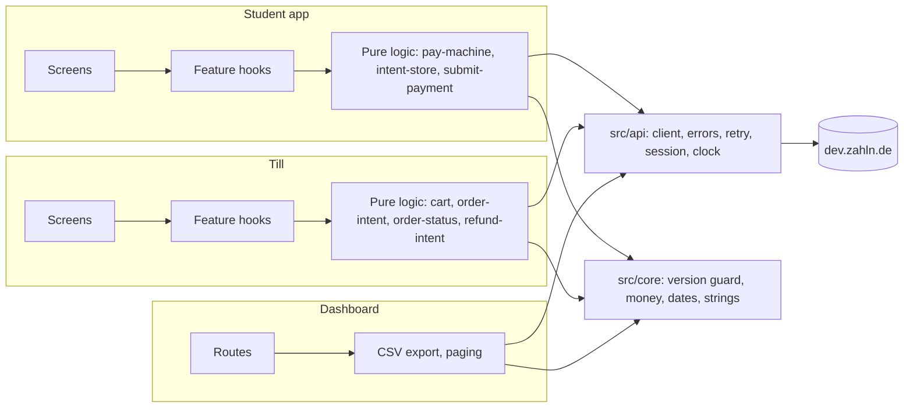
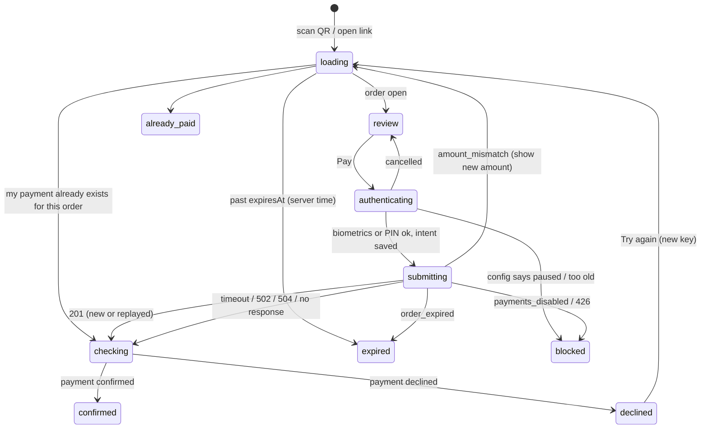
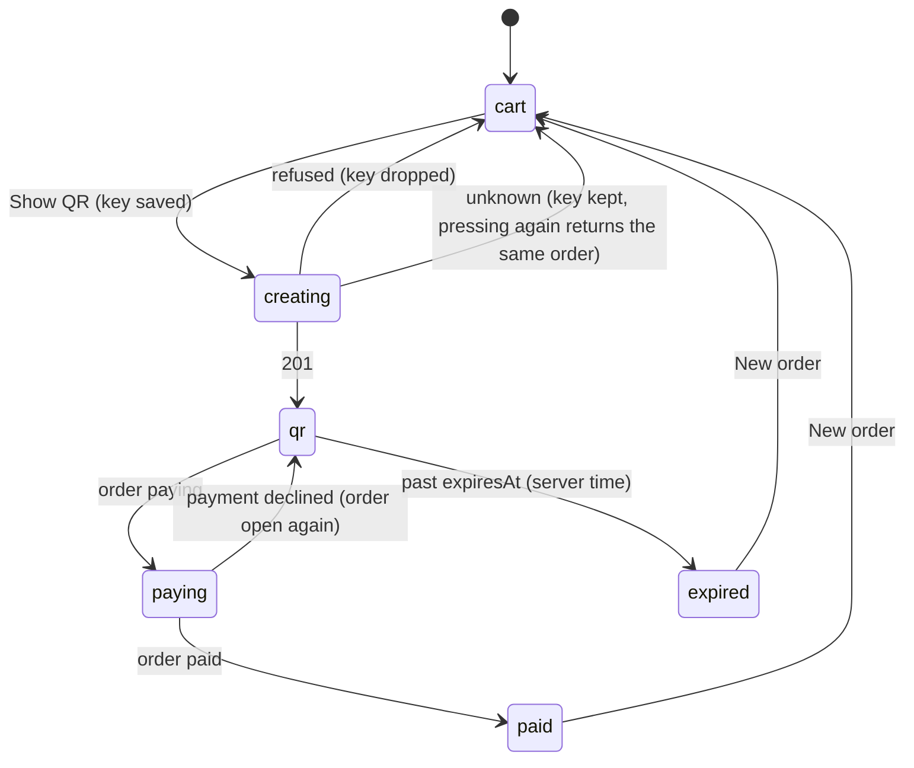

# Zahln Mensa: design

Three surfaces for one payment flow: the student app (Expo, iOS and Android), the till (Expo, tablet, landscape) and the Studierendenwerk dashboard (React, web). This document covers how they are built, how a payment moves through its states when things go wrong, how I would ship and secure it, and what I would change in the API.

## 1. Architecture and what is shared

Each surface has three layers: screens render, a hook per feature owns state and effects, and the decisions that matter (can I pay, what does this error mean, which version wins) live in plain TypeScript with no React import, so they run under Vitest in milliseconds. Tests sit in a `__tests__/` folder next to the code they cover.

**Shared code**

| Module | Student | Till | Dashboard | Why it is shared |
|---|---|---|---|---|
| `api/client.ts`: timeout, retry with backoff, `Idempotency-Key`, re-login on `session_expired`, `Date` header clock | yes | yes | yes | Every surface talks to the same unreliable server. One retry policy, tested once. |
| `api/errors.ts`: problem+json into `rejected` / `not_applied` / `unknown` | yes | yes | yes | The single most important distinction in the client: "the server said no" versus "we do not know". |
| `api/schema.ts`: generated from `openapi.json` | yes | yes | yes | The spec is the contract; nothing is typed by hand. |
| `api/endpoints.ts` plus one folder per domain (`orders/`, `payments/`, ...) with `index.ts` calls and `interface.ts` types | own set | own set | own set | Each app carries only the endpoints it calls; `api-instance.ts` owns the client and the session. |
| `core/version.ts`: keep the higher `version` | yes | yes | yes | Stale reads must never replace newer state. |
| `core/money.ts`, `core/date.ts`, `core/i18n` | yes | yes | yes | Cents and Berlin time are formatted the same everywhere. |
| `ui/`: tokens and five RN primitives | yes | yes | no | Same look on phone and till. |
| `api/faults.ts`: dev-only fault injection | yes | yes | no | Reproduces lost responses, 503s and stale reads on demand. |

**Deviation from the brief.** The brief asks for one monorepo. This submission is three repositories, each runnable on its own, with `src/api` and `src/core` copied between them. Each surface ships on its own schedule: the phone app through the stores, the till as an internal tablet build, the dashboard on every push. Separate repositories keep each one's history, CI and release independent. It costs a real thing: a change to the client has to be made three times. The transport and money logic (`api/client.ts`, `errors.ts`, `session.ts`, `clock.ts`, `core/version.ts`, `version-cache.ts`, `money.ts`) is byte-identical in all three today; the domain folders, the strings and the dashboard's Berlin-time helpers differ on purpose, because each surface carries only what it uses. Moving the identical part into one workspace (npm workspaces, `packages/api`, `packages/core`) is an import-path change, not a refactor.

## 2. How a payment moves through its states

The rule the whole client follows: a screen only shows what the server confirmed. "We do not know yet" is its own state and is never shown as success or as failure.

### On the phone

What makes it safe:

1. **The intent is written before the request leaves the phone.** `intent-store.ts` saves `{orderId, idempotencyKey, amount, user}` to MMKV, then the POST goes out. Every retry, and every relaunch after a crash, reuses that key. The server replays the original payment instead of creating a second one.
2. **A second tap cannot create a second intent.** `intents.start()` returns the live intent for the order if one exists, and the Pay button is driven by state, not by a local flag.
3. **An unknown outcome stays "checking".** After the client gives up retrying, the screen keeps resending the same key every few seconds. That either returns the payment (replay) or a definite refusal. It never says "failed".
4. **Relaunch resumes.** On start, Home looks for a live intent and opens that payment before anything else.
5. **Every payment read is version-guarded.** A stale `pending` arriving after `confirmed` is dropped, in the pay flow, in lists and on detail screens. Lists and detail screens each keep their own cache of the highest version seen per payment, and the till does the same for orders.
6. **Expiry uses server time.** The offset comes from the `Date` header of every response; the countdown and the last check before sending both use it.
7. **The connection recovers after a network change.** End-to-end testing with airplane mode found that Android's HTTP client kept reusing a dead HTTP/2 connection after the network came back, so every retry hung until it timed out and the payment only completed after an app restart. A small config plugin (`plugins/with-network-recovery.js`) now pings connections every 10 s and drops the pool whenever the default network changes; the same flow now completes as soon as the network returns.
8. **Long pending is honest.** After 30 s the screen says the payment is still being checked and that leaving is safe.

Cleared only when the outcome is known: `confirmed`, `declined`, or a definite refusal that cannot hide a payment. `order_payment_in_progress` and `idempotency_mismatch` keep the intent, because a payment may be behind them. Once one attempt's answer is lost, the client reports any later refusal for that request (an expired session, payments paused) as unknown too, because the lost attempt may already have charged; the screen stays in checking. The checking loop resends with the same key and, if that is refused, asks the order whether a payment exists before it clears the intent. And if the order cannot even be loaded while an attempt is on record, the screen keeps retrying instead of saying nothing was charged.

### On the till

The till polls `GET /orders/{id}` every 1.5 s, keeps the highest version, and shows **Paid** only on `paid`, with the amount and price group of the confirmed payment. Only the server ends an order: when the local countdown reaches zero the till keeps polling, because a student may have paid in the last second; it shows **Expired** only when the server says so. A created order's key is never reused for the next customer. The QR never shows a price: the price depends on who scans. While an order is open or paying, the till does not let the cashier leave the QR: the API has no way to cancel an order, so a second ring-up could leave the first one payable and the customer could pay both. The cashier leaves through **New order** once the server has ended the order.

**Refunds** follow the same pattern: one intent per payment with its own key, the button is disabled while a refund is in flight, a lost response is resent with the same key on reopen, and "Refunded" appears only when the refund is `completed`. Refusals (`refund_exceeds_payment`, `refund_window_closed`, `payment_not_refundable`, another till) each have their own message, and the amount is checked against `refundableAmountCents` before sending.

### How this is tested

- **Unit (Vitest):** 113 tests in the student app, 116 in the till, 81 in the dashboard. The client tests script `504, 502, 201` and assert three calls with the same key; the intent tests simulate a relaunch over the same storage; the state machine tests cover stale polls, expiry during biometrics and every refusal code.
- **End to end (Maestro, against the real mock):** pay, each price group, lost response, app killed mid-payment, double tap, network lost while confirming (airplane mode), server answering 503 to every payment request, German; till ring-up to paid, refunds, lost create, network lost while showing the QR, till restarted while showing the QR. Each payment flow asks the server afterwards that exactly one payment exists for the order.
- **Release builds:** every flow that needs no dev fault switch also runs against the release APKs.
- **Dashboard (Playwright):** going offline and back, sign in, totals, attention list, search, payment history, CSV download (header and rows checked), German, reload.

## 3. Shipping an app that cannot be hotfixed

- **Kill switch and forced update already work.** `GET /config` is read at start and again right before paying. `paymentsEnabled: false` blocks Pay with an explanation; `minAppVersion` above the app version shows "update required". The server enforces both (503 `payments_disabled`, 426), so a phone that never read the config is still stopped.
- **Releases:** internal track, then a staged rollout (1 %, 10 %, 50 %, 100 %) with crash-free sessions and payment success rate as gates. A bad build is stopped by halting the rollout and, if it is already out, raising `minAppVersion`.
- **What can be changed without a release:** copy and simple flags through remote config; logic only through a store release. I would not ship JS over-the-air updates for the pay path: the flow that moves money should be the reviewed binary.
- **Compatibility:** the client ignores unknown fields, so the API can add fields without breaking old apps. New enum values are not handled yet; before release every status switch should map an unknown value to a neutral "check later" state rather than crash.
- **Crash reporting (not built):** Sentry with release and dist set per build, source maps uploaded in CI, PII scrubbing on, and a breadcrumb for each pay state transition (state names only, no amounts or ids).
- **CI (not built):** typecheck, Vitest and lint on every push; Maestro and Playwright nightly and before a release; release builds only from tagged commits.

## 4. Security and data protection on the device

- **Tokens** live in memory only. The app keeps the seeded username and the user's display name and price group in MMKV, so Home renders straight after the splash and the first API call signs in again in the background (no loading screen on launch; about 650 ms cold start on a Moto G60). In production the sign-in would use a refresh token in the Keychain / Keystore (`expo-secure-store`), never anything in plain storage.
- **The PIN** (used when the phone has no biometrics or screen lock) is stored as a salted SHA-256 hash in SecureStore. For production I would derive it with a slow KDF and rate-limit attempts; better still, require a device screen lock and let the OS own the secret.
- **Payment confirmation** goes through the OS (`expo-local-authentication`), which falls back to the device PIN; the app never sees biometric data.
- **Stored data** is limited to the pending intent (order id, key, amount) and preferences. No card data exists; payment history is fetched, not cached to disk.
- **Logs** contain no tokens, amounts or user ids.
- **QR input** is parsed strictly (`zahln://pay?order=ord_…` or a bare `ord_…`); anything else is rejected before a request is made.
- **Dashboard:** the password is never stored, not even in memory beyond the tab's life. The session token is kept in a cookie (`Secure`, `SameSite=Strict`, `Path=/`) whose `Max-Age` is the token's remaining life, at most five minutes, so a reload or a new tab stays signed in and the cookie disappears with the token; signing out deletes it. When the token expires, finance signs in again and returns to the same page and filters. The cookie is set from JavaScript, so it cannot be `HttpOnly` and a script injected into the page could read it, exactly as it could read `sessionStorage`. The API hands out the token in the response body and expects it in the `Authorization` header, so only a server can do better: in production a small backend-for-frontend would sign in on finance's behalf and set an `HttpOnly; Secure; SameSite=Strict` cookie, and the token would never reach the browser's JavaScript. CSV cells starting with `= + - @`, or a tab or carriage return, are prefixed so Excel does not run them as formulas.
- **German rules this already follows.**
  - *Fonts:* the dashboard bundles Inter and Plus Jakarta Sans itself instead of loading them from Google. LG München I (20 Jan 2022, 3 O 17493/20) held that loading Google Fonts sends the visitor's IP to Google without a legal basis; self-hosting sends nothing. The apps embed the same fonts in the build.
  - *Storage without a consent banner:* the only things written to the browser or device are the session token, the pending payment intent, the saved user and the language. Each is needed for a service the user asked for, which is the exception in § 25 (2) Nr. 2 TDDDG. There is no analytics, tracking or third-party script, so nothing needs consent.
  - *Accessibility:* payment services and their apps fall under the Barrierefreiheitsstärkungsgesetz (BFSG) since 28 June 2025, with EN 301 549 / WCAG 2.1 AA as the bar. The pay flow has labels, live announcements for every result and focus moved to the result; a full audit against EN 301 549 is still open.
  - *Strong customer authentication (PSD2, RTS 2018/389 Art. 5):* the payer must see the amount and the payee, and the authentication must be bound to both. The app shows the amount and the mensa on the review screen and inside the biometric prompt, and the server refuses a changed amount (`amount_mismatch`). The binding itself cannot be done by this client: the API has no authentication challenge, so the server never learns that biometrics passed. See §6.
  - *Before a real launch:* a privacy notice (Art. 13 GDPR) and an Impressum (§ 5 DDG) on the public dashboard URL, a data processing agreement with the hosting provider, and a deletion concept for payment data beyond the retention the payment rules require.
- **Not done for the mock, needed for production:** certificate pinning or at least a pinned CA list, root/jailbreak signals sent to the server, screenshot blocking on the pay screen (`FLAG_SECURE`), and wiping state on sign-out.

## 5. Technology choices, and what I would change about yours

| Choice | Why |
|---|---|
| Expo SDK 58, Expo Router, React Native 0.88 (New Architecture) | Required by the brief; config plugins keep native code out of the repo. |
| TanStack Query for reads | Lists, paging and refetch intervals for pending items. Sending money never goes through it: the pay flow is a reducer with an explicit submit and checking loop; a refund is an intent with a fixed key and a resend timer, and only the refund's status is read through `useQuery` with a refetch interval. |
| Zustand | Two tiny stores (session, language). |
| react-native-mmkv | Synchronous storage, so the intent exists on disk before the request is sent. |
| expo-local-authentication, expo-secure-store, expo-crypto | OS-owned confirmation, keystore-backed secrets, UUID keys. |
| expo-camera | QR scanning without an extra native library. |
| react-native-qrcode-svg | Small, renders the till QR. |
| Vite + React 19 + react-router | The dashboard is a client of an existing API; no server rendering needed. |
| Vitest, Maestro, Playwright | Fast unit tests for logic; Maestro drives the real apps; Playwright for the web, because Maestro's web support (beta) could not fill the login form. |
| openapi-typescript | Types come from your spec, not from my reading of it. |

What I would change about your setup: publish the OpenAPI spec as a versioned package (or at least version the URL) so clients can pin it, and give the mock a documented way to force a specific failure for a single request (a header such as `X-Mock-Fault: lose-response`). Today failures are random, which makes a specific failure hard to reproduce in a test; I built client-side fault injection to work around that.

## 6. What the API is missing, and what I would change

1. **No way to cancel an order.** A cashier who rang up the wrong items has to wait five minutes for it to expire, while the customer could still pay it. The till therefore keeps the cashier on the QR until the server ends the order; a `POST /orders/{id}/cancel` that fails once a payment has started would let the till offer Cancel safely.
2. **No push.** The till and the phone must poll. A WebSocket or SSE stream per order (or per till) would cut latency and load at lunch rush.
3. **No lookup of a POST by its Idempotency-Key.** After a lost response the only way to learn the outcome is to send the same POST again. `GET /payments?idempotencyKey=…` would let a client check without risking anything.
4. **No list of a till's orders.** The till cannot show "orders waiting for payment" after a restart (it only remembers the one it showed), and a test cannot count orders.
5. **No `GET /refunds/{id}`.** A refund's status is read through the whole payment.
6. **Payment status changes have no timestamps on the order.** The till shows "paid" but not when, which matters for disputes.
7. **`amountCents` must be sent back on pay.** I understand it guards against a changed price, but an order version (`"orderVersion": 3`) would do the same job and also catch item changes.
8. **The token cannot be refreshed.** Clients must keep credentials to sign in again every five minutes; a refresh token would remove that. There is also no sign-out: signing out only forgets the token on the device, and the server keeps accepting it until it expires. A `DELETE /sessions/current` that revokes it would close that window on a shared till or office computer.
9. **Daily totals carry no `version` and no as-of time.** A late or stale read cannot be told apart from a fresh one; the dashboard shows when it fetched and refreshes today every minute, but only the server knows how current the numbers are.
10. **`netCents` and `refundedCents` are not defined in the spec.** From the data, `refundedCents` counts refunds completed on that day, for payments made on any day, so a day's net can go below its own gross minus its own refunds. The dashboard says so on screen; the spec should.
11. **Totals have no figure for pending refunds.** Finance sees money that is promised back only by opening each payment.
12. **No server-side export.** The dashboard pages through `GET /payments` 100 at a time to build the CSV. For a month of a large campus that is many requests; an export endpoint (or a signed download link) would be one.
13. **No strong customer authentication.** Biometrics or the PIN are checked on the phone only; the pay request carries nothing the server can verify. PSD2 asks for an authentication bound to the amount and the payee. I would have `POST /orders/{id}/payments` return a challenge that includes both, sign it with a device key held in the Keystore / Secure Enclave and unlocked by biometrics, and only then accept the payment.
